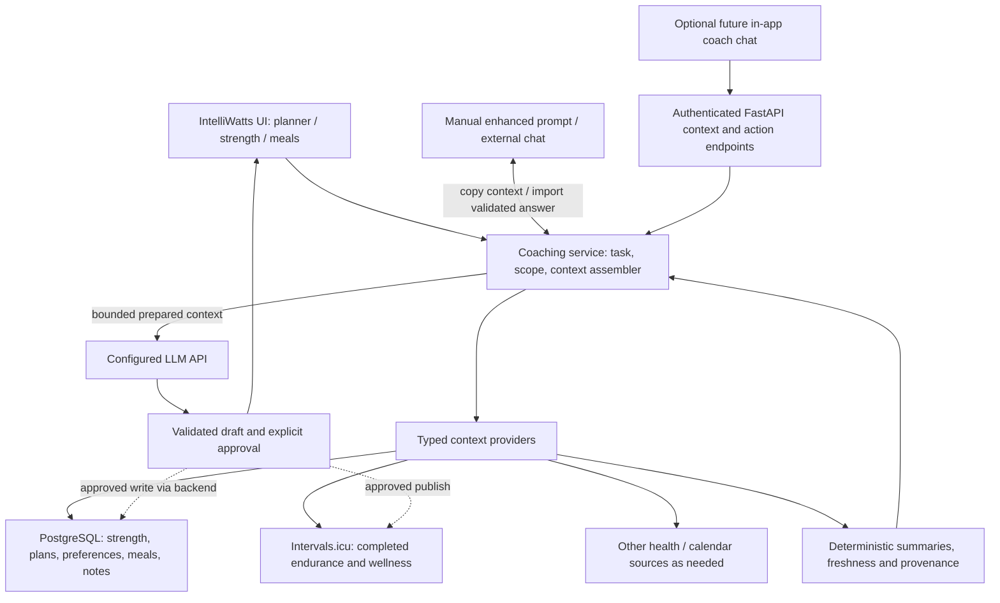

# IntelliWatts — unified athlete coaching roadmap

**Status:** Authoritative product and architecture plan (2026-11-12). This document is the **single source of truth for future work** on IntelliWatts. It replaces the previous cycling-dashboard extension and general improvement backlogs; completed functionality is described in the README, while source audits and backup instructions remain separate operational references.

## 1. Product goal and non-goals

Build one dependable personal coaching system that can **collect and interpret health/recovery, endurance, strength and nutrition context**, and help plan training across sports so decisions build on prior prescriptions and actual execution.

A useful result: “Given my cycling, strength, football, sleep/recovery, available time, goals and nutrition preferences, propose next week; explain conflicts and trade-offs; keep changes as drafts until approved.”

IntelliWatts is **already the starting point**: it has FastAPI, SQLModel/PostgreSQL, Intervals.icu data ingestion, deterministic analytics, saved cycling plans, model-based generation, and a **Manual / External LLM** flow that exports enhanced prompts and validates the returned plan JSON. **Extend this system, do not replace it.**

Non-goals unless a real need emerges: a second web app, microservices, a generic CMS or rule engine, a vector database, arbitrary LLM-generated SQL, a compulsory MCP server, complete replication of external provider datasets, or a custom chat frontend before useful workflows exist. **A personal VPS is a viable deployment option**, not an architectural rewrite.

## 2. Architectural decision

**One FastAPI monolith + PostgreSQL for app-owned data + task-specific context providers + one shared context assembler.** Keep Jinja/Tailwind for structured workflows. The deployment may remain managed or move to a privately accessed VPS; the application architecture stays the same.

1. **Providers fetch data on behalf of the model.** Small typed providers query PostgreSQL through SQLModel/SQLAlchemy, read Intervals.icu or other authenticated APIs, and return normalized, time-stamped data. The LLM chooses a **named capability or provider scope**, not raw SQL. Provider tokens and DB connections stay server-side. For an external client, use a narrowly authenticated FastAPI API or optional MCP adapter over those exact same providers.
2. **Extend current domain objects.** Reuse `User`, `TrainingPhase`, `LongTermPlanArtifact`, `TrainingPlan`, `WorkoutDelivery`, the Intervals client and `app/services/coach_context.py`. The existing cycling planner is the starting workflow; avoid introducing a second general weekly-plan store just to display multiple sports. Start with a joined weekly *view* over saved cycling plans, performed strength, provider activities and commitments. When scheduling prescribed strength becomes necessary, add the **smallest explicit planned-strength-session record**, linked to the existing week/phase, rather than encoding strength sets as cycling intervals.
3. **Separate facts, calculations and decisions.** Source records are facts; source-aware, testable functions calculate metrics; the LLM interprets compact, bounded evidence and proposes actions. Do not rely on a prompt to compute strength volume, activity counts, missingness, or source deduplication. Do not equate cycling TSS with uncalibrated strength/football loads.
4. **One context pipeline, multiple delivery modes.** For predefined planning tasks, the backend selects domain providers and assembles a compact context for either API model generation or the existing Manual / External LLM prompt. For future free-form questions, the user/model may select additional **read-only provider calls** through bounded FastAPI endpoints or internal function calling. All write operations still use validated proposals and a deliberate confirmation step.
5. **Free-form access is a supported direction, not a second data plane.** Expose explicit read capabilities such as `get_endurance`, `get_strength_history`, `get_recovery`, `get_athlete_context`, `get_meals` and `get_week_review`, and optionally `get_everything` as a **bounded manifest + compact cross-domain summary**, not a raw dump. A lightweight `GET /api/v1/context` (scopes, date ranges, detail level) can serve an authenticated external client or a copied enhanced prompt. Keep interactive chat optional; MCP is merely one future transport.
6. **Personal-use security and data hygiene.** This is a **single-owner project**: no multi-user roles, registration, consent-management system or compliance bureaucracy is required for ordinary personal use. Keep private data/credentials out of Git, logs and unwanted LLM prompts; choose which health details to share. Preserve source fidelity and the ability to export or delete your own records. Wellness indicators support coaching, not autonomous medical diagnosis.

### Source ownership (logical unity, not compulsory data copying)

| Domain | Authority | What IntelliWatts holds |
| --- | --- | --- |
| Cycling/endurance completed activities, power, available wellness | **Intervals.icu** | Read through existing adapter; cache bounded summaries with IDs, timestamps and freshness only when justified |
| Strength performed sessions/sets | **Google Sheets until verified cutover; then IntelliWatts** | Stable exercise IDs, immutable historical execution with auditable corrections, templates/versions, native new logs |
| Cycling and cross-sport planned decisions | **IntelliWatts** | Existing phases/plans/delivery state, approved changes and linkages to external calendar events |
| Athlete goals, schedule constraints, notes and coaching knowledge selected for retention | **IntelliWatts** after staged migration | Existing profile first; simple categorized Markdown/text records where structured fields are unnecessary |
| Meal cards, recipes, meal assignments and food preferences | **IntelliWatts** when feature ships | Text/tags first; quantities/ingredients only where actually sourced or entered |
| Health and recovery measurements | **Originating provider** when available; **IntelliWatts** for manual check-ins | Explicitly dated self-reports; limited provider references/caches, units, missingness and source provenance |
| External calendar commitments | Existing Intervals calendar adapter initially | Only commitments needed for scheduling; do not write duplicate events without explicit approval |

At eventual retirement, every private Hybrid Athlete OS item should be **imported if wanted, marked duplicate/obsolete, or deliberately excluded**. A private Git archive is a recovery copy, not the active knowledge base. Neither Git snapshots nor spreadsheet dashboards become additional authorities.

### Architecture and request flow

The **backend is the data broker**. Providers are Python functions or focused service classes, not separate microservices or one network connector per source. A future chat may ask for follow-up data without starting a new planning job. Existing API and Manual / External LLM modes continue working without chat.

### Provider contract and query modes

Start by extracting common selection logic from the existing `app/services/coach_context.py` and planner adapters **only when a second caller needs it**. Avoid replacing the working cycling flow up front. Each provider accepts typed inputs (time window, requested domain, detail limit) and returns source IDs, units, timestamps/freshness, missing-data indicators and normalized results; add deterministic calculations only where the provider owns them.

| Capability | Typical data | Baseline implementation |
| --- | --- | --- |
| `get_athlete_context` | Goals, schedule, preferences and active coaching constraints | Existing user/phase/profile and selected retained Markdown |
| `get_endurance` | Recent activities, load, planned-vs-performed cycling, provider wellness | Existing Intervals client and analytics; preserve source IDs and dates |
| `get_strength_history` | Sessions, comparable exercise progression, last set measurements | Native strength tables after verified Sheets import |
| `get_recovery` | Dated check-ins, available baseline and wellbeing signals | Existing coach-context recovery calculations; add private records only when needed |
| `get_week_review` | Intended sessions, actual activity, conflicts and uncertainty | Small composition of existing plans, strength history and provider evidence |
| `get_meals` | Meal cards, preferences and candidate recipes | Protected app content and tags after meal feature ships |
| `get_everything` | Overview of **available domains**, timestamps, concise aggregates and links to further scopes | **Composition** of the above, bounded by dates/size; never an unrestricted SQL query or entire private history |

**Specific task mode:** Weekly planning selects a predictable small bundle of providers, computes factual summaries and sends one context envelope to the configured model or Manual prompt. This makes results comparable and reduces tokens.

**Free-flowing mode:** An authenticated client calls a documented endpoint such as `GET /api/v1/context?scopes=endurance,strength,recovery&from=...&to=...&detail=summary`. The backend validates ranges, response sizes, access and requested fields; returns JSON with source/freshness warnings. The LLM can request a second provider only when needed. A `get_everything` request returns a **bounded overview** with an available-domains manifest and suggested follow-up scopes, not every set/note/health reading. Detailed bulk export is a separate deliberate owner action, not a conversational default.

**API exposure distinction:** “Public FastAPI endpoints” may mean *documented API routes* (and optional OpenAPI schemas). It must **not** mean unauthenticated athlete-data URLs. If hosted on a VPS, the API can be private to Tailscale or protected by Cloudflare Access; if an outside LLM service must call it directly, that specific client needs a separately authorized access route. A Cloudflare Tunnel alone provides connectivity, not identity verification. Always restrict API access and avoid static credentials inside shared enhanced prompts.

**Writes:** Context endpoints are read-only. Plan generation returns a validated draft, and publishing or editing data occurs through existing authenticated application actions after your explicit review. Any future LLM action tool has a narrower permission contract than the context reader.

### Context acceptance tests

- **Provider fidelity:** Latest source values, IDs, units, blanks and freshness survive normalization; provider outage is reported as unknown, not “no training”.
- **Composability:** A free-form question about cycling + strength can retrieve those providers without loading unrelated nutrition/health records. A scoped `get_everything` remains bounded, paginated or summary-only under large histories.
- **Plan continuity:** Week N+1 considers approved Week N plans, performed work, rescheduled/skipped/modified/unmatched sessions, and conflicting football/strength days; no matches based on date alone when identity is ambiguous.
- **Model independence:** The provider/API path and Manual enhanced prompt use the same normalized evidence and validation; generated prompts show what athlete information would leave the application.
- **Permission boundary:** Unauthenticated context reads fail; a model cannot request unrestricted SQL, credentials or mutations through a read provider. Synthetic tests cover injection attempts and oversized time windows.

## 3. Delivery sequence and acceptance gates

Deliver the smallest working feature with its relevant source data. These are **independently reviewable PRs**, not a mandate to create every candidate table immediately.

| Phase | Deliverable | Exit gate |
| --- | --- | --- |
| **0 — Inventory** | Structural audit of both repos and the Google workbook, source ownership, recovery runbook | **Done: structural only.** Private backups and restore tests are **not** thereby verified |
| **1 — Safety and strength persistence** | Independently encrypted source backups, actual Neon `pg_dump` → isolated `pg_restore`, restricted test-branch Alembic upgrade; minimal strength schema, basic HTTP/privacy fixes and a security review of existing secrets/session access | Real restore and test-branch migration succeed **before deploy**. [Implementation PR #155](https://github.com/matze298/intelliwatts/pull/155) remains separate; passing CI does not authorize production deployment |
| **2 — Native strength logging** | Exercise library, versioned templates, mobile-friendly workout logger; idempotent import of the complete authoritative Sheets history and active strength blueprint | Reconcile source IDs/joins/statuses/sets/versions/unknowns; verify edited/read-back native sessions; take final source delta; switch to **one** writer only after approval |
| **3 — Shared training context** | Extend existing deterministic coach context with performed strength, prior planned-vs-completed cycling, sport commitments and dated recovery evidence; expose compact enhanced prompts | Provider-API and Manual / External LLM produce equivalent evidence and validated draft outputs; stale/missing data clearly labeled |
| **4 — Joint week planning** | Coordinate cycling + strength + football/other commitments, prior load and recovery in one weekly plan/review; preserve sport-specific structures; add minimal planned-strength entries only when needed | Week N+1 accounts for Week N intentions **and** actual execution, detects conflicts, explains trade-offs, and never publishes externally without approval |
| **5 — Meals and nutrition** | Import meal ideas, tags and preferences; weekly assignments, leftovers and training-day fueling suggestions; add complete recipes, quantities and shopping lists only where supported | Weekly meal workflow accounts for long rides, strength and other sessions; no invented portions, macros, nutrient deficits or logged intake |
| **6 — Recovery/health and retained knowledge** | Add lightweight dated check-ins; selectively integrate verified wearable measurements and remaining wanted Markdown notes; complete additional authentication, data-access and retention safeguards **before** importing more sensitive health details | Current check-ins and provider freshness are handled responsibly; private records selected for retention are in protected DB; authentication, deletion and disclosure rules are tested; no invented clinical conclusions |
| **7 — Optional coach chat** | If recurring open-ended questions justify it, introduce conversational UI over the same read-only context functions, not a new data plane | Questions yield grounded answers from relevant sources; prompt injection and permission-boundary tests pass; unapproved mutations are impossible; enhanced prompt mode still works |
| **8 — Retire legacy systems** | Account for every old file and Sheets record, verify Intervals snapshot coverage, stop obsolete syncs, archive sources | No runtime reliance on the private repo or Google Sheets as a writer; recovery and per-domain reconciliation independently verified |

**Ordering flexibility:** Read-only context work can start alongside the strength logger; recovery check-ins or meals may move earlier if valuable. Chat is not a prerequisite for joint planning or nutrition. **Exceptions:** a tested database restore comes before production schema changes; documented one-writer reconciliation comes before strength cutover; and stronger access, retention and deletion safeguards come before expanding sensitive health data. This documentation-only PR meets none of those operational gates.

## 4. Open points retained from the former planning documents

These are **ideas or unsatisfied requirements**, not claims that the data or features already exist. Keep them prioritized under the phases above rather than maintaining a second enhancement roadmap.

| Open work | Where addressed | Scope control / proof of value |
| --- | --- | --- |
| **Planned vs. actual performance and plan adherence**, including Intervals scheduled workouts | Phases 3–4 | Establish session matching rules, provider IDs, statuses and explicit unknowns; distinguish canceled, shifted, missed, unrecorded and modified sessions; don't assume same-day means same workout and don't silently rewrite approved history |
| **Recovery change against individual baseline** with missing-data indicators | Phases 3 and 6 | Extend current coach-context logic only as needed; don't replace its working cycling summaries or use one wearable number as a hard stop |
| **Sleep quality vs. training load** deeper analysis (e.g. REM/deep-sleep associations) | Phase 6, **deferred** | Validate upstream data coverage, timestamps and confounders first; explore trends descriptively, not as causal or medical claims |
| **Nutrition and fueling insights**, potentially informed by food logging tools | Phase 5, **optional extension** | Start with recipes/meal planning; no mandatory MyFitnessPal integration or automatic burned-versus-eaten calorie balance without reliable intake data |
| **Postgres recovery, source archive, Google Sheets fidelity and Intervals snapshot coverage** | Phases 1, 2 and 8 | Real private backup + restore and source-specific reconciliations; no public exports |
| **Broader sports data/health source adapters** | Phases 3, 4 and 6 | Use existing Intervals data first; only integrate another provider for a clear missing metric or workflow |
| **Improved UI, trend charts, build/CI reliability** | **Already delivered**, summarized in README and test suite | Do not reopen completed dashboard design, 365-day range, activity mix, intensity/power and weekly-volume charts as new projects without a new defect |

The prior `docs/dashboard-expansions.md` listed five delivered chart enhancements and three unbuilt ideas. The prior `docs/improvement-plan.md` listed completed security, backend, UI and CI improvements and one open coaching-context task. **Only the remaining work is carried forward here.** Completed implementation and tests remain in Git history and the README.

## 5. Lightweight implementation rules

- **Native operations where chat is slower:** strength set logging, plan/calendar review, recipe/meal selection and approvals deserve simple interfaces. A large multi-tab “fitness OS” is not required.
- **Strength fidelity:** exercise identity survives variations; preserve historical per-side data, units, blank-vs-zero, RIR and template version; never mark unknown sessions completed or invent performed sets. Keep import reports private.
- **Planning safety:** distinguish plans, completions, current self-reported state and model suggestions. Existing cycling-hours/session limits remain **cycling-specific**; only introduce an explicit overall training-time/strain budget and secondary goal priorities when a concrete cross-sport conflict requires them. Save a revision/draft; publish to Intervals only after explicit review; retain existing cycling regressions.
- **Nutrition:** start with meal cards and dietary preferences; consider meal/fueling timing around long rides and demanding sessions. Do not infer grams, calories, macros, energy availability or actual food intake where unknown. Treat nutrition recommendations as coaching support, not medical advice.
- **Backups:** a test branch is not an off-provider backup; a download is not an independently stored archive. A real restore of production data is required before changing production schema. Rollback must account for writes made after cutover.
- **Security:** no arbitrary SQL from LLM, no database credentials in browser/tool contexts, no routine broad raw-health prompts or private exports in public repos and CI. Minimize retained health fields, define deletion/retention before adding new sensitive data, and make external prompt disclosure understandable. Add API-level tools later only behind existing authentication, authorization, rate limits and explicit write confirmation.
- **Hosting:** stay on Render + Neon until cost, reliability or actual background processing makes another choice demonstrably better. Do not buy a VPS merely to centralize data.
- **Testing and release:** each feature PR uses synthetic fixtures, typed validation, database migration tests when applicable and cycling workflow regression tests. For cross-sport proposals, test a real scheduling conflict and a missing-data case, not only an ideal week. Separate operational recovery sign-off from CI. No dual writers during source cutover.

## 6. Security evolution beyond the shared password

**Current state (source inspection, not a penetration test):** IntelliWatts uses a single application password, signed 12-hour session cookie, a shared database-backed login throttle, same-origin checks on mutations, and server-side API credentials. [Draft PR #155](https://github.com/matze298/intelliwatts/pull/155) proposes additional response cache/framing headers. A public HTTPS URL does **not** mean the database itself is public, and paid hosting alone does not provide stronger app authentication. The current single-password design provides **no independent second factor** or per-device session revocation. Verify actual deployment configuration and auth handling before asserting that any particular safeguard is active.

**Required before new sensitive health-data collection or broad access:**

1. **Threat model and privacy inventory.** Identify what is protected (training logs, personal notes, check-ins, health measurements, model prompts, provider tokens), who can reach the public app, how backups/logs and third-party LLMs receive data, and what deletion/retention periods are appropriate. Include a practical data export and deletion procedure.
2. **Stronger sign-in, without custom identity-platform work.** Choose a well-maintained managed OIDC identity provider or an access gateway with MFA/passkeys as the preferred route for a personal app; compare against a carefully implemented single-user WebAuthn/passkey or TOTP extension only if a managed service creates more friction or cost than benefit. Never treat an IP allowlist, a second password, a shared secret in a URL, or a private browser tab as MFA. Preserve a secure recovery path to avoid account lockout. Do **not** build user registration/roles just to protect one account.
3. **Session and action security.** Assess session fixation, idle and absolute expiry, explicit server-side revocation/logout, `Secure`/`HttpOnly`/`SameSite` cookies, origin/CSRF behavior, HSTS/TLS, brute-force controls and monitoring. Require fresh confirmation for sensitive account/credential changes, private data exports and external training/calendar writes.
4. **Secret and data protection.** Use separate least-privileged app/backup database credentials, restrict production DB exposure, rotate and revoke provider tokens, minimize logged payloads and error tracebacks, and keep backups encrypted and **independently restorable**. Verify schema/data access and retention/deletion in application services; defense-in-depth policies (including row restrictions) are optional if a future multi-user use case justifies them.
5. **LLM boundary.** Treat source documents, retrieved web content and model outputs as untrusted. Use bounded authorized read functions, a prompt-content disclosure preview and output schemas; require an explicit approval flow for all mutations. Test prompt-injection attempts that ask the model to reveal secrets or execute unauthorized actions, including the Manual / External LLM response import path.
6. **Verification.** Add synthetic regression tests for unauthorized access, CSRF/origin, safe errors, expired/revoked sessions, health-data exclusion from prompts, restricted export, approvals and data deletion; review dependency/security alerts and deployment configuration. Independent penetration testing is a later option if exposure or stored sensitivity materially increases.

**Decision gate:** Move beyond a single password **before** collecting substantially more sensitive health information or enabling broad natural-language access, rather than postponing all security work until a future chat feature. The strength-data backup and existing access requirements remain prerequisites for their respective production cutovers.

## 7. Hosting decision: free managed, paid managed, or VPS?

**Default: retain the existing Render + Neon managed architecture, verify backups first, and upgrade individual services when real reliability or security requirements justify the cost.** Infrastructure exposure and authentication are separate decisions: moving the same password-protected application to a VPS does not make it private.

| Option | Advantages | Limitations and operating responsibility | Appropriate trigger |
| --- | --- | --- | --- |
| **Current free managed tiers** | Very low cost; managed deployments, TLS, Postgres and minimal operations | Free Render web services idle/suspend, cold-start and lack paid features; free Neon compute scales to zero, has usage limits and short recovery history; neither is a substitute for independent backups | Development, low-frequency personal use and disposable prototypes while availability expectations are modest |
| **Paid Render web service + Neon Free or Launch** | Remove Render's free web cold-start; keep managed TLS/deploy workflow; independently upgrade database limits/recovery when needed | Ongoing web cost, possible database wake-ups/usage-based costs; backups and application auth still your responsibility | **First upgrade to consider** when the app should respond reliably on demand, needs scheduled/background work, or more predictable operation |
| **Paid managed web + paid managed database** | Longer recovery features, adjustable capacity and continued low operational burden | Highest recurring provider bill of these managed options, but little infrastructure maintenance | A validated recovery window, availability target, usage or data criticality exceeds free-tier limits |
| **Single self-managed VPS** | Full control over app/database/network and potentially consolidated compute cost | You own OS and dependency updates, firewall, secrets, reverse proxy/TLS, monitoring, restart policies, backup encryption, **off-host restore**, on-call troubleshooting and recovery; app+DB on one host increases correlated failure risk | Only if measured managed-service costs/features or a specific operational requirement justify the extra maintenance and restore testing |

**Current provider facts checked November 2026:** Render's Free web service spins down after 15 minutes idle and can take around a minute to restart; it does not provide a durable filesystem. Render's public pricing lists low-cost paid web compute with more dependable service behavior, without needing a paid team workspace. Neon Free includes scale-to-zero and a short point-in-time recovery window; the Neon Launch plan is usage-based and offers additional recovery options. **Prices, caps and feature names change: verify the official current billing pages before choosing a plan.** References: [Render free limitations](https://render.com/docs/free), [Render pricing](https://render.com/pricing), [Neon Free plan and limits](https://neon.com/pricing), [Neon plans](https://neon.com/pricing).

**Measure first:** Record current Render idle delays, app latency, monthly request/background-job requirements, Neon compute/storage usage, required recovery-point/recovery-time objectives, backup restore success and actual planned monthly spend. Compare an on-demand, single-athlete use case against those facts. Do not assume continuous availability or sensitive-data safety merely because a service is paid; likewise do not assume a VPS is more secure merely because it is privately administered.

**Recommended order:** (1) independently restorable encrypted Neon backup and app secrets recovery; (2) stronger authentication/security for sensitive health data; (3) upgrade Render web compute if its cold starts/reliability actually cause problems; (4) upgrade Neon when usage, recovery history or operational capability justifies it; (5) consider a VPS only after demonstrating a clear total-cost or control benefit that exceeds its ongoing maintenance risk.

## 8. Status, artifacts and decision log

- **Current shipped baseline:** The [README](../README.md) documents the cycling planner, coach prompt, Intervals.icu dashboard, manual enhanced-prompt/import path, secure sign-in and managed PostgreSQL persistence. Do not represent planned strength, meals, free-form chat or unified coaching as shipped.
- **Step 0 inventory:** [Source and authority audit](hybrid-athlete-step-0-inventory.md) records inspected file groups and mapping evidence, **not future architecture policy**.
- **Operational recovery:** [Private backup/restore checklist](hybrid-athlete-step-0-recovery.md) records mandatory source-specific safeguards, **not a competing delivery roadmap**.
- **Step 1 implementation:** [Draft PR #155](https://github.com/matze298/intelliwatts/pull/155) proposes strength tables and response privacy hardening; it carries additional operator instructions on its branch. **Reconcile it with this plan before merging.** Its Neon restoration gates remain unverified until separately evidenced.

**Decision:** IntelliWatts remains the one application and secure data-access boundary. The LLM receives relevant, prepared context through existing backend services, either as an integrated API call or as an inspectable enhanced prompt. Free-form chat is a later interface option; external MCP/connectors and direct SQL access are **not** prerequisites for unified training and nutrition coaching.

**Maintenance convention:** Update **this file** for roadmap priorities, architecture choices, deferred ideas and completion state. The README describes implemented behavior; source inventories and recovery runbooks hold operational evidence; don't create another feature backlog in Markdown.
