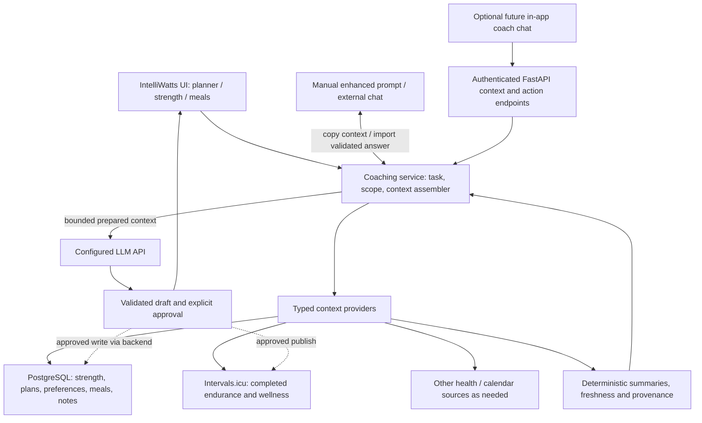

# IntelliWatts — unified athlete coaching roadmap

**Purpose:** The authoritative target architecture, outstanding delivery work and permanent product principles. This is not a changelog or a description of shipped functionality. See the [README](../README.md) for the implemented baseline, [AGENTS.md](../AGENTS.md) for development instructions, and pull requests/Git history for completed changes. Remove work from the active roadmap only after its acceptance gate is satisfied; retain outstanding requirements for partially delivered phases.

## 1. Product vision and non-goals

Build one dependable personal coaching system that can **collect and interpret health/recovery, endurance, strength and nutrition context**, and help plan training across sports so decisions build on prior prescriptions and actual execution.

A useful result: “Given my cycling, strength, football, sleep/recovery, available time, goals and nutrition preferences, propose next week; explain conflicts and trade-offs; keep changes as drafts until approved.”

**Extend the existing IntelliWatts application; do not replace it.**

Non-goals unless a real need emerges: a second web app, microservices, a generic CMS or rule engine, a vector database, arbitrary LLM-generated SQL, a compulsory MCP server, complete replication of external provider datasets, or a custom chat frontend before useful workflows exist. **A personal VPS is a viable deployment option**, not an architectural rewrite.

## 2. Target architecture

**One FastAPI monolith + PostgreSQL for app-owned data + task-specific context providers + one shared context assembler.** Keep Jinja/Tailwind for structured workflows. The deployment may remain managed or move to a privately accessed VPS; the application architecture stays the same.

1. **Providers fetch data on behalf of the model.** Small typed providers query PostgreSQL through SQLModel/SQLAlchemy, read Intervals.icu or other authenticated APIs, and return normalized, time-stamped data. The LLM chooses a **named capability or provider scope**, not raw SQL. Provider tokens and DB connections stay server-side. For an external client, use a narrowly authenticated FastAPI API or optional MCP adapter over those exact same providers.
2. **Extend current domain objects.** Reuse `User`, `TrainingPhase`, `LongTermPlanArtifact`, `TrainingPlan`, `WorkoutDelivery`, the Intervals client and `app/services/coach_context.py`. The existing cycling planner is the starting workflow; avoid introducing a second general weekly-plan store just to display multiple sports. Start with a joined weekly *view* over saved cycling plans, performed strength, provider activities and commitments. When scheduling prescribed strength becomes necessary, add the **smallest explicit planned-strength-session record**, linked to the existing week/phase, rather than encoding strength sets as cycling intervals.
3. **Separate facts, calculations and decisions.** Source records are facts; source-aware, testable functions calculate metrics; the LLM interprets compact, bounded evidence and proposes actions. Do not rely on a prompt to compute strength volume, activity counts, missingness, or source deduplication. Do not equate cycling TSS with uncalibrated strength/football loads.
4. **One context pipeline, multiple delivery modes.** For predefined planning tasks, the backend selects domain providers and assembles a compact context for either API model generation or the existing Manual / External LLM prompt. For future free-form questions, the user/model may select additional **read-only provider calls** through bounded FastAPI endpoints or internal function calling. All write operations still use validated proposals and a deliberate confirmation step.
5. **Free-form access is a supported direction, not a second data plane.** Expose explicit read capabilities such as `get_endurance`, `get_strength_history`, `get_recovery`, `get_athlete_context`, `get_meals` and `get_week_review`, and optionally `get_everything` as a **bounded manifest + compact cross-domain summary**, not a raw dump. A lightweight `GET /api/v1/context` (scopes, date ranges, detail level) can serve an authenticated external client or a copied enhanced prompt. Keep interactive chat optional; MCP is merely one future transport.
6. **Personal-use security and data hygiene.** This is a **single-owner project**: no multi-user roles, registration, consent-management system or compliance bureaucracy is required for ordinary personal use. Keep private data/credentials out of Git, logs and unwanted LLM prompts; choose which health details to share. Preserve source fidelity and the ability to export or delete your own records. Wellness indicators support coaching, not autonomous medical diagnosis.

### Target source ownership (logical unity, not compulsory data copying)

| Domain | Target authority / transition | Intended IntelliWatts responsibility |
| --- | --- | --- |
| Cycling/endurance completed activities, power, available wellness | **Intervals.icu** | Read through existing adapter; cache bounded summaries with IDs, timestamps and freshness only when justified |
| Strength performed sessions/sets | **Google Sheets until verified cutover; then IntelliWatts** | Stable exercise IDs, immutable historical execution with auditable corrections, templates/versions, native new logs |
| Cycling and cross-sport planned decisions | **IntelliWatts** | Existing phases/plans/delivery state, approved changes and linkages to external calendar events |
| Athlete goals, schedule constraints, notes and coaching knowledge selected for retention | **IntelliWatts** after staged migration | Existing profile first; simple categorized Markdown/text records where structured fields are unnecessary |
| Meal cards, recipes, meal assignments and food preferences | **IntelliWatts** when feature ships | Text/tags first; quantities/ingredients only where actually sourced or entered |
| Health and recovery measurements | **Originating provider** when available; **IntelliWatts** for manual check-ins | Explicitly dated self-reports; limited provider references/caches, units, missingness and source provenance |
| External calendar commitments | Existing Intervals calendar adapter initially | Only commitments needed for scheduling; do not write duplicate events without explicit approval |

At eventual retirement, every private Hybrid Athlete OS item should be **imported if wanted, marked duplicate/obsolete, or deliberately excluded**. A private Git archive is a recovery copy, not the active knowledge base. Neither Git snapshots nor spreadsheet dashboards become additional authorities.

### Target architecture and request flow

The diagram describes the intended system, including future providers and optional chat; it does not imply these features are shipped.

The **backend is the data broker**. Providers are Python functions or focused service classes, not separate microservices or one network connector per source. A future chat may ask for follow-up data without starting a new planning job. Existing API and Manual / External LLM modes continue working without chat.

### Provider contract and query modes

Start by extracting common selection logic from the existing `app/services/coach_context.py` and planner adapters **only when a second caller needs it**. Avoid replacing the working cycling flow up front. Each provider accepts typed inputs (time window, requested domain, detail limit) and returns source IDs, units, timestamps/freshness, missing-data indicators and normalized results; add deterministic calculations only where the provider owns them.

| Proposed capability | Typical data | Implementation starting point |
| --- | --- | --- |
| `get_athlete_context` | Goals, schedule, preferences and active coaching constraints | Existing user/phase/profile and selected retained Markdown |
| `get_endurance` | Recent activities, load, planned-vs-performed cycling, provider wellness | Existing Intervals client and analytics; preserve source IDs and dates |
| `get_strength_history` | Sessions, comparable exercise progression, last set measurements | Native strength tables after verified Sheets import |
| `get_recovery` | Dated check-ins, available baseline and wellbeing signals | Existing coach-context recovery calculations; add private records only when needed |
| `get_week_review` | Intended sessions, actual activity, conflicts and uncertainty | Small composition of existing plans, strength history and provider evidence |
| `get_meals` | Meal cards, preferences and candidate recipes | Protected app content and tags after meal feature ships |
| `get_everything` | Overview of **available domains**, timestamps, concise aggregates and links to further scopes | **Composition** of the above, bounded by dates/size; never an unrestricted SQL query or entire private history |

**Specific task mode:** Weekly planning selects a predictable small bundle of providers, computes factual summaries and sends one context envelope to the configured model or Manual prompt. This makes results comparable and reduces tokens.

**Free-flowing mode:** An authenticated client calls a documented endpoint such as `GET /api/v1/context?scopes=endurance,strength,recovery&from=...&to=...&detail=summary`. The backend validates ranges, response sizes, access and requested fields; returns JSON with source/freshness warnings. The LLM can request a second provider only when needed. A `get_everything` request returns a **bounded overview** with an available-domains manifest and suggested follow-up scopes, not every set/note/health reading. Detailed bulk export is a separate deliberate owner action, not a conversational default.

**API exposure distinction:** “Public FastAPI endpoints” may mean *documented API routes* (and optional OpenAPI schemas). It must **not** mean unauthenticated athlete-data URLs. If hosted on a VPS, the API can be private to Tailscale or protected by Cloudflare Access; if an outside LLM service must call it directly, that specific client needs a separately authorized access route. A Cloudflare Tunnel alone provides connectivity, not identity verification. Always restrict API access and avoid static credentials inside shared enhanced prompts.

**Writes:** Context endpoints are read-only. Plan generation returns a validated draft, and publishing or editing data occurs through existing authenticated application actions after your explicit review. Any future LLM action tool has a narrower permission contract than the context reader.

### Context acceptance tests

- **Provider fidelity:** Latest source values, IDs, units, blanks and freshness survive normalization; provider outage is reported as unknown, not “no training”.
- **Composability:** A free-form question about cycling + strength can retrieve those providers without loading unrelated nutrition/health records. A scoped `get_everything` remains bounded, paginated or summary-only under large histories.
- **Plan continuity:** Week N+1 considers approved Week N plans, performed work, rescheduled/skipped/modified/unmatched sessions, and conflicting football/strength days; no matches based on date alone when identity is ambiguous.
- **Model independence:** The provider/API path and Manual enhanced prompt use the same normalized evidence and validation; generated prompts show what athlete information would leave the application.
- **Permission boundary:** Unauthenticated context reads fail; a model cannot request unrestricted SQL, credentials or mutations through a read provider. Synthetic tests cover injection attempts and oversized time windows.

## 3. Active delivery roadmap

Only outstanding work belongs here. Phase numbers are stable for existing references; completed or deferred phases are not active tasks. Status describes delivery, not merely code availability: **In review / blocked** means implementation is proposed but the release gate is outstanding; **Open** means further implementation or verification is required; **Planned** means a later deliverable. CI success alone does not establish operational or coaching acceptance.

### Delivery phases

| Phase | Status / priority | Remaining deliverable | Acceptance gate |
| --- | --- | --- | --- |
| **1 — Safety and strength persistence** | **In review / blocked** | Review [draft PR #158](https://github.com/matze298/intelliwatts/pull/158) (minimal strength schema and privacy headers); independently encrypted Neon logical backup, retrieval and actual isolated restore; production-like test-branch Alembic upgrade; remaining session/secrets review | Actual backup restore and test migration succeed **before merging/deploying** the schema; startup runs migrations. Synthetic CI is not restoration evidence. |
| **2 — Native strength logging** | **Planned** | Verified independently recoverable full Sheets export and private Git history before their respective imports; exercise library, versioned templates, mobile-friendly logger, idempotent complete history and active blueprint import | Reconcile IDs/joins/statuses/sets/versions/unknowns; verify edits/readback, final source delta and exactly one writer after approval. |
| **3 — Shared context providers and API** | **Open / high priority** | Remaining cycling-context gaps below; add native strength reads and task-specific context composition; expose authenticated read-only scopes and bounded `get_everything` | Manual and API generation share evidence; custom questions select scopes/periods; outages, freshness, permissions and oversized requests are handled. |
| **4 — Joint week planning** | **Open / high priority** | Actual-versus-planned session analysis and upcoming commitments below; coordinate cycling, strength and other sports; add minimal planned strength entries only when necessary | Week N+1 considers earlier intentions and actual execution, resolves conflicts without confusing sports' budgets, explains trade-offs, and requires approval before publishing. |
| **5 — Meals and nutrition** | **Planned** | Meal ideas, tags/preferences, weekly assignments, leftovers and training-day fueling; recipes, quantities and shopping lists only where supported | Meals account for demanding sessions; no invented portions, macros, deficits or intake. |
| **6 — Recovery/health and retained knowledge** | **Planned** | Lightweight dated check-ins, verified relevant wearable measurements and wanted private notes; proportionate authentication, data-access and retention safeguards before expanding sensitive detail | Current check-ins and freshness; protected retention, tested auth/deletion/disclosure; no invented clinical conclusions. |
| **8 — Retire legacy systems** | **Planned / after cutover** | Account for every old file and Sheets record, check Intervals snapshot coverage, stop obsolete syncs and archive sources | No runtime dependence on private repo or Sheets writer; independent recovery and domain reconciliation verified. |

### Remaining work within phases 3–6

These are refinements of the phases above, not separate projects. Cycling improvements can ship independently before strength consolidation.

| Work item | Phase / priority | Acceptance |
| --- | --- | --- |
| Plan adherence and interval execution | 3–4 / high | Match stable IDs where available; distinguish canceled, shifted, missed, unrecorded and modified sessions. Compare key interval dose, quality and available RPE/feedback. Never match merely by date or rewrite approved history silently. |
| Cycling intensity and performance | 3 / high | Cycling-only 7/28-day power/HR zone distributions, definitions and recording coverage, hard-session frequency and long-ride duration; goal-relevant power-duration trends without assuming maximal efforts. |
| Data coverage and prompt consistency | 3 / high | Preserve valid activity identity and duration when stress is unknown; distinguish no observations from zero load/rest, report freshness/coverage, refresh specialist evidence on revisions and bound history while retaining current plan/feedback. Deduplicate macro and workload summaries. |
| Upcoming commitments | 4 / high | Include relevant races and sports from today through target week; deduplicate published workouts by ID and refresh provisional future plans after actual sessions. |
| Practical athlete constraints | 4 / as needed | Optional daily time, indoor/outdoor preferences, event demands and current limitations only where they improve scheduling. |
| Recovery evidence and baseline | 3, 6 / as needed | Extend existing personal baseline comparisons with relevant new sources and coverage; add selective dated feedback without assuming scales or inventing symptoms. |
| Additional sport/health adapters | 3, 4, 6 / as needed | Use Intervals data first; add task-relevant typed providers with stable units, dates and source ownership, not one integration per LLM. |

**Ordering:** Read-only context work can proceed independently of strength logging; meals and recovery check-ins can move earlier if useful. Chat is not a dependency.

**Hard gates:** Verified private DB restore and production-like migration before deploying schema changes; source-specific recoverable archives before respective imports; one-writer reconciliation before strength cutover; authenticated access and adequate backup hygiene before exposing additional health records. Security sophistication remains proportional to a single-owner deployment.

**Operational references:** [Source and authority inventory](hybrid-athlete-step-0-inventory.md) and [private backup/restore checklist](hybrid-athlete-step-0-recovery.md) describe source evidence and recovery procedures. The more detailed Phase 1 operator runbook is in [draft PR #158](https://github.com/matze298/intelliwatts/pull/158). Do not interpret inventory or documented commands as verified recovery.

## 4. Deferred and optional features

These are not delivery gates. Promote an item into the active roadmap only when a concrete need justifies it.

| Option | Condition for pursuing |
| --- | --- |
| Configured FTP reference and effective date | Useful execution calibration only; never required for a relative %FTP prescription or fitness assessment. |
| Cycling-only CTL/ATL trends | If they improve decisions beyond existing workload/recovery evidence; include adequate warm-up, dates and explicit assumptions. |
| Sleep architecture vs. load (e.g. REM/deep sleep) | Validate coverage, timestamps and confounders; descriptive trends only, not causal or clinical claims. |
| Nutrition/food logging integration | Only if useful after meal workflow exists; no mandatory MyFitnessPal or inferred burned-versus-eaten balance. |
| **Phase 7 — Optional coach chat / MCP** | If free-flowing use warrants it, use the same authenticated providers and endpoints. Multi-turn scoped retrieval, prompt-injection/permission tests and deliberate write approval; keep Manual prompts working. |
| Stronger sign-in / MFA / passkeys and hosting migration | Based on actual exposure, convenience and operational trade-offs; follow security principles and hosting strategy below. |

## 5. Permanent implementation principles

- **Native operations where chat is slower:** strength set logging, plan/calendar review, recipe/meal selection and approvals deserve simple interfaces. A large multi-tab “fitness OS” is not required.
- **Strength fidelity:** exercise identity survives variations; preserve historical per-side data, units, blank-vs-zero, RIR and template version; never mark unknown sessions completed or invent performed sets. Keep import reports private.
- **Planning safety and productive time:** distinguish plans, completions, current self-reported state and model suggestions. Treat available cycling hours/sessions as capacity to use productively, aiming for the maximum sustainable cycling dose rather than an arbitrary fraction. Favor easy aerobic time when recovery supports it, progress toward availability when recent volume is lower, and explain concrete reasons for substantial unused hours (e.g. 2h prescribed from 5h available). Do not force sudden jumps or overload around other sports, competitions or tapers. These limits remain **cycling-specific**; add an overall time/strain budget only when concrete cross-sport conflicts require one. Save a revision/draft; publish to Intervals only after explicit review; retain existing cycling regressions.
- **FTP-independent planning:** prescribe relative %FTP workouts regardless of whether FTP is missing, old or unchanged; prioritize actual execution, workload and recovery, with RPE/HR cues for calibration. Don't invent watt targets, infer stagnation or require a recent FTP test.
- **Relevant coaching evidence:** keep prompts dated, compact and task-specific. Use recorded sleep duration, cautiously interpreted sleep scores and multi-day individual HRV/RHR trends; do not normalize ambiguous imported sleep-quality categories. Preserve source/scale uncertainty; never treat one wearable metric as an automatic veto. Do not routinely send raw historical activities, GPS, full wellness notes, all-time curves or mixed-sport load as cycling fitness. Avoid universal recovery thresholds and intensity-style labels unsupported by actual distribution.
- **Nutrition:** start with meal cards and dietary preferences; consider meal/fueling timing around long rides and demanding sessions. Do not infer grams, calories, macros, energy availability or actual food intake where unknown. Treat nutrition recommendations as coaching support, not medical advice.
- **Backups:** a test branch is not an off-provider backup; a download is not an independently stored archive. A real restore of production data is required before changing production schema. Rollback must account for writes made after cutover.
- **Security:** no arbitrary SQL from LLM; no DB/API secrets in client prompts, browser JavaScript or public Git; no unbounded health record dumps. Keep personal export/delete practical, authenticate all data endpoints and require approval for actions. Do not add multi-user registration, per-user consent screens or enterprise compliance processes for this single-owner app.
- **Hosting:** Render + Neon and a small Tailscale-protected VPS are both credible. Choose on price, availability, remote access, backups and actual maintenance effort; no architectural dependency on either. Keep independent encrypted off-host backups for both.
- **Testing and release:** each feature PR uses synthetic fixtures, typed validation, database migration tests when applicable and cycling workflow regression tests. Cover mixed sports, sparse/stale observations, missed intervals, future weeks, revisions and provider outages; privately compare representative prompts and prescriptions before claiming improved coaching. Separate operational recovery sign-off from CI. No dual writers during source cutover.

### Proportional security for a single-owner application

**Scope:** This system is primarily for **one person**. There is no need for user registration, multiple roles, consent-management workflows, organizational compliance machinery or a custom identity platform just because health-related data is involved. The owner decides what to record and sends to LLM services. Security still matters because it protects a real personal training history, API tokens and private notes.

**Security requirements, in order of value:**

1. **Restrict who can reach the app.** On a VPS, prefer Tailscale-only access for personal devices; if browser access outside the tailnet is required, use a Cloudflare Tunnel **with Cloudflare Access authentication/policies**, not a freely reachable tunnel URL. Tailscale itself restricts the app at the network layer; configure bind addresses, firewall and proxy ingress so the origin is **not also directly reachable** on a public IP. An OpenAPI description can be visible to the owner without exposing real records to anonymous callers.
2. **Protect the data and recovery path.** Keep provider and PostgreSQL secrets out of public Git, local copies of enhanced prompts and logs; use least-privileged roles, TLS when crossing networks, encrypted **off-VPS and off-provider backups**, and actually test restoring them. If app + DB share one VPS, a failed host must not take the only backup with it. Keep a simple data export/delete capability for personal control, not consent screens.
3. **Harden the existing session and future API.** Check `Secure`/`HttpOnly`/`SameSite` cookies, logout/session invalidation, login throttling, origin/CSRF behavior, error responses and dependency updates. Existing password auth can remain a second gate behind private network/Access; adding passkeys/MFA is **optional** if actual exposure or convenience justifies it, not an automatic blocker for strength/check-in work.
4. **Secure free-form data access.** All context endpoints require app-session or scoped client authentication **and** private-network/Access reachability according to the chosen deployment. Use explicit read-only scopes, bounded query windows, request quotas and response caps. Do not expose `get_everything` as anonymous public JSON or give an LLM arbitrary SQL. Keep separate authenticated write routes with validation and deliberate confirmation.
5. **LLM behavior and testing.** Treat outside text, model-produced tool requests and manual imported responses as untrusted. Test that a prompt cannot fetch credentials, bypass provider scopes, overfetch historical health data or publish workouts without approval. For enhanced prompts, show a preview of the actual information being copied.

**Deployment-dependent gate:** If the site is publicly reachable, stronger web authentication (e.g. Cloudflare Access with an appropriate second factor or a managed passkey flow) is worth prioritizing before expanding sensitive health detail. If the app is genuinely restricted to your Tailscale devices, existing password + safe sessions + protected backups may be entirely proportional. The network perimeter **must be tested**, not assumed; a tunnel alone does not prove that unauthenticated outsiders cannot access it. No blanket requirement for MFA or consent UI in a personal-only tool.

## 6. Hosting strategy: managed services or a personal VPS?

**Both choices are reasonable.** Codex/automation can reduce the setup burden of Linux hardening, Tailscale, reverse proxies and backups, so a VPS should not be dismissed as inherently too hard. Automation does not, however, eliminate responsibility for security patches, credential rotation, backup restoration and diagnosing outages.

| Option | Benefits | Costs / caveats | Choose when |
| --- | --- | --- | --- |
| **Free Render + Neon** | No server administration, simple deployments, minimal cash cost | Sleeping app/compute, limited restore horizon and plan quotas, internet-facing login by default | Occasional personal use while cold starts and limits are tolerable |
| **Paid Render + Neon (free or paid)** | Managed deployment/patching and better app responsiveness; upgrade DB independently | Recurring provider cost; provider backup/restore and app access still need attention | You value low maintenance or want always-ready access |
| **Small VPS + managed Neon** | Private Tailscale ingress, predictable always-on app, complete control of app/runtime without self-hosting PostgreSQL | Need reverse proxy, security updates, monitoring, process restart and app backups; Neon remains a separate cost/source | You want private access and low app hosting cost but prefer managed DB recovery |
| **Small VPS + PostgreSQL on VPS** | Most control and potentially good cost for this small workload; private DB, no extra managed-DB dependency | Host/disk failure affects **both** app and DB unless an independent encrypted off-host backup and tested recovery exist; PostgreSQL updates, disk monitoring, replication/PITR decisions and restores become your responsibility | You are comfortable operating it, have reproducible deployment and restore drills, and accept the recovery target |

**Candidate private access pattern:** your laptop/phone → Tailscale → VPS app; optional browser access via Cloudflare Tunnel **plus Access** → same app. Close the VPS's direct public HTTP/DB ingress and confirm routes cannot bypass Access. A Cloudflare Tunnel is not itself authentication and a public hostname is not equivalent to a private-only service. If an external hosted LLM/chat client must call FastAPI directly, its traffic **cannot use your Tailscale identity by default**: explicitly provision a narrowly authenticated service route (for example via Access service token / validated app credential with short scope), or keep it inside the app's server-side LLM workflow. Do not hand external services Tailscale credentials or Neon credentials.

**Decision approach:** compare total monthly spend, cold starts, latency, recovery time, actual DB footprint, job scheduling needs and ongoing maintenance. Record simple target numbers (e.g. maximum acceptable restore data loss, time to restore, app wake-up delay) rather than debating unspecified SLA promises. A managed DB can be worth paying for independently of where FastAPI runs.

**Decision principle:** Do not migrate infrastructure just to implement the unified coach. A **Tailscale-restricted VPS is a credible alternative**, especially given your willingness to administer it with Codex; evaluate VPS+Neon versus VPS+Postgres and managed hosting after the existing backup gate is satisfied. If you move, perform a rehearsal deployment and isolated data restoration first, keep a rollback window, and turn off old hosting only after equivalent functions and backups are verified.

Provider pricing and free limits change; check [Render Free](https://render.com/docs/free), [Render pricing](https://render.com/pricing), [Neon pricing](https://neon.com/pricing), [Tailscale documentation](https://tailscale.com/kb) and [Cloudflare Access documentation](https://developers.cloudflare.com/cloudflare-one/identity/) before committing to a provider or security feature.
