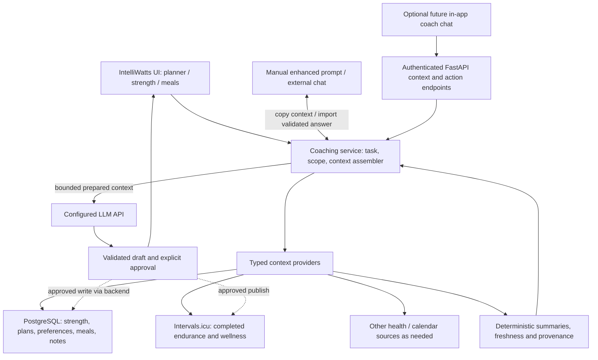

# IntelliWatts — unified athlete coaching roadmap

**Status:** Authoritative product and architecture plan (2026-11-12). This document is the **single source of truth for future work** on IntelliWatts. It replaces the previous cycling-dashboard extension and general improvement backlogs; completed functionality is described in the README, while source audits and backup instructions remain separate operational references.

## 1. Product goal and non-goals

Build one dependable personal coaching system that can **collect and interpret health/recovery, endurance, strength and nutrition context**, and help plan training across sports so decisions build on prior prescriptions and actual execution.

A useful result: “Given my cycling, strength, football, sleep/recovery, available time, goals and nutrition preferences, propose next week; explain conflicts and trade-offs; keep changes as drafts until approved.”

IntelliWatts is **already the starting point**: it has FastAPI, SQLModel/PostgreSQL, Intervals.icu data ingestion, deterministic analytics, saved cycling plans, model-based generation, and a **Manual / External LLM** flow that exports enhanced prompts and validates the returned plan JSON. **Extend this system, do not replace it.**

Non-goals unless a real need emerges: a second web app, microservices, a generic CMS or rule engine, a vector database, arbitrary LLM-generated SQL, a compulsory MCP server, complete replication of external provider datasets, or a custom chat frontend before useful workflows exist. **A personal VPS is a viable deployment option**, not an architectural rewrite.

## 2. Architectural decision

**One FastAPI monolith + PostgreSQL for app-owned data + task-specific context providers + one shared context assembler.** Keep Jinja/Tailwind for structured workflows. The deployment may remain managed or move to a privately accessed VPS; the application architecture stays the same.

1. **Providers fetch data on behalf of the model.** Small typed providers query PostgreSQL through SQLModel/SQLAlchemy, read Intervals.icu or other authenticated APIs, and return normalized, time-stamped data. The LLM chooses a **named capability or provider scope**, not raw SQL. Provider tokens and DB connections stay server-side. For an external client, use a narrowly authenticated FastAPI API or optional MCP adapter over those exact same providers.
2. **Extend current domain objects.** Reuse `User`, `TrainingPhase`, `LongTermPlanArtifact`, `TrainingPlan`, `WorkoutDelivery`, the Intervals client and `app/services/coach_context.py`. The existing cycling planner is the starting workflow; avoid introducing a second general weekly-plan store just to display multiple sports. Start with a joined weekly *view* over saved cycling plans, performed strength, provider activities and commitments. When scheduling prescribed strength becomes necessary, add the **smallest explicit planned-strength-session record**, linked to the existing week/phase, rather than encoding strength sets as cycling intervals.
3. **Separate facts, calculations and decisions.** Source records are facts; source-aware, testable functions calculate metrics; the LLM interprets compact, bounded evidence and proposes actions. Do not rely on a prompt to compute strength volume, activity counts, missingness, or source deduplication. Do not equate cycling TSS with uncalibrated strength/football loads.
4. **One context pipeline, multiple delivery modes.** For predefined planning tasks, the backend selects domain providers and assembles a compact context for either API model generation or the existing Manual / External LLM prompt. For future free-form questions, the user/model may select additional **read-only provider calls** through bounded FastAPI endpoints or internal function calling. All write operations still use validated proposals and a deliberate confirmation step.
5. **Free-form access is a supported direction, not a second data plane.** Expose explicit read capabilities such as `get_endurance`, `get_strength_history`, `get_recovery`, `get_athlete_context`, `get_meals` and `get_week_review`, and optionally `get_everything` as a **bounded manifest + compact cross-domain summary**, not a raw dump. A lightweight `GET /api/v1/context` (scopes, date ranges, detail level) can serve an authenticated external client or a copied enhanced prompt. Keep interactive chat optional; MCP is merely one future transport.
6. **Personal-use security and data hygiene.** This is a **single-owner project**: no multi-user roles, registration, consent-management system or compliance bureaucracy is required for ordinary personal use. Keep private data/credentials out of Git, logs and unwanted LLM prompts; choose which health details to share. Preserve source fidelity and the ability to export or delete your own records. Wellness indicators support coaching, not autonomous medical diagnosis.

### Source ownership (logical unity, not compulsory data copying)

| Domain | Authority | What IntelliWatts holds |
| --- | --- | --- |
| Cycling/endurance completed activities, power, available wellness | **Intervals.icu** | Read through existing adapter; cache bounded summaries with IDs, timestamps and freshness only when justified |
| Strength performed sessions/sets | **Google Sheets until verified cutover; then IntelliWatts** | Stable exercise IDs, immutable historical execution with auditable corrections, templates/versions, native new logs |
| Cycling and cross-sport planned decisions | **IntelliWatts** | Existing phases/plans/delivery state, approved changes and linkages to external calendar events |
| Athlete goals, schedule constraints, notes and coaching knowledge selected for retention | **IntelliWatts** after staged migration | Existing profile first; simple categorized Markdown/text records where structured fields are unnecessary |
| Meal cards, recipes, meal assignments and food preferences | **IntelliWatts** when feature ships | Text/tags first; quantities/ingredients only where actually sourced or entered |
| Health and recovery measurements | **Originating provider** when available; **IntelliWatts** for manual check-ins | Explicitly dated self-reports; limited provider references/caches, units, missingness and source provenance |
| External calendar commitments | Existing Intervals calendar adapter initially | Only commitments needed for scheduling; do not write duplicate events without explicit approval |

At eventual retirement, every private Hybrid Athlete OS item should be **imported if wanted, marked duplicate/obsolete, or deliberately excluded**. A private Git archive is a recovery copy, not the active knowledge base. Neither Git snapshots nor spreadsheet dashboards become additional authorities.

### Architecture and request flow

The **backend is the data broker**. Providers are Python functions or focused service classes, not separate microservices or one network connector per source. A future chat may ask for follow-up data without starting a new planning job. Existing API and Manual / External LLM modes continue working without chat.

### Provider contract and query modes

Start by extracting common selection logic from the existing `app/services/coach_context.py` and planner adapters **only when a second caller needs it**. Avoid replacing the working cycling flow up front. Each provider accepts typed inputs (time window, requested domain, detail limit) and returns source IDs, units, timestamps/freshness, missing-data indicators and normalized results; add deterministic calculations only where the provider owns them.

| Capability | Typical data | Baseline implementation |
| --- | --- | --- |
| `get_athlete_context` | Goals, schedule, preferences and active coaching constraints | Existing user/phase/profile and selected retained Markdown |
| `get_endurance` | Recent activities, load, planned-vs-performed cycling, provider wellness | Existing Intervals client and analytics; preserve source IDs and dates |
| `get_strength_history` | Sessions, comparable exercise progression, last set measurements | Native strength tables after verified Sheets import |
| `get_recovery` | Dated check-ins, available baseline and wellbeing signals | Existing coach-context recovery calculations; add private records only when needed |
| `get_week_review` | Intended sessions, actual activity, conflicts and uncertainty | Small composition of existing plans, strength history and provider evidence |
| `get_meals` | Meal cards, preferences and candidate recipes | Protected app content and tags after meal feature ships |
| `get_everything` | Overview of **available domains**, timestamps, concise aggregates and links to further scopes | **Composition** of the above, bounded by dates/size; never an unrestricted SQL query or entire private history |

**Specific task mode:** Weekly planning selects a predictable small bundle of providers, computes factual summaries and sends one context envelope to the configured model or Manual prompt. This makes results comparable and reduces tokens.

**Free-flowing mode:** An authenticated client calls a documented endpoint such as `GET /api/v1/context?scopes=endurance,strength,recovery&from=...&to=...&detail=summary`. The backend validates ranges, response sizes, access and requested fields; returns JSON with source/freshness warnings. The LLM can request a second provider only when needed. A `get_everything` request returns a **bounded overview** with an available-domains manifest and suggested follow-up scopes, not every set/note/health reading. Detailed bulk export is a separate deliberate owner action, not a conversational default.

**API exposure distinction:** “Public FastAPI endpoints” may mean *documented API routes* (and optional OpenAPI schemas). It must **not** mean unauthenticated athlete-data URLs. If hosted on a VPS, the API can be private to Tailscale or protected by Cloudflare Access; if an outside LLM service must call it directly, that specific client needs a separately authorized access route. A Cloudflare Tunnel alone provides connectivity, not identity verification. Always restrict API access and avoid static credentials inside shared enhanced prompts.

**Writes:** Context endpoints are read-only. Plan generation returns a validated draft, and publishing or editing data occurs through existing authenticated application actions after your explicit review. Any future LLM action tool has a narrower permission contract than the context reader.

### Context acceptance tests

- **Provider fidelity:** Latest source values, IDs, units, blanks and freshness survive normalization; provider outage is reported as unknown, not “no training”.
- **Composability:** A free-form question about cycling + strength can retrieve those providers without loading unrelated nutrition/health records. A scoped `get_everything` remains bounded, paginated or summary-only under large histories.
- **Plan continuity:** Week N+1 considers approved Week N plans, performed work, rescheduled/skipped/modified/unmatched sessions, and conflicting football/strength days; no matches based on date alone when identity is ambiguous.
- **Model independence:** The provider/API path and Manual enhanced prompt use the same normalized evidence and validation; generated prompts show what athlete information would leave the application.
- **Permission boundary:** Unauthenticated context reads fail; a model cannot request unrestricted SQL, credentials or mutations through a read provider. Synthetic tests cover injection attempts and oversized time windows.

## 3. Delivery sequence and acceptance gates

Deliver the smallest working feature with its relevant source data. These are **independently reviewable PRs**, not a mandate to create every candidate table immediately.

| Phase | Deliverable | Exit gate |
| --- | --- | --- |
| **0 — Inventory** | Structural audit of both repos and the Google workbook, source ownership, recovery runbook | **Done: structural only.** Private backups and restore tests are **not** thereby verified |
| **1 — Safety and strength persistence** | Independently encrypted source backups, actual Neon `pg_dump` → isolated `pg_restore`, restricted test-branch Alembic upgrade; minimal strength schema, basic HTTP/privacy fixes and a security review of existing secrets/session access | Real restore and test-branch migration succeed **before deploy**. [Proposed Phase 1 foundation](hybrid-athlete-step-1-foundation.md) remains unmerged until private restore evidence exists; passing CI does not authorize production deployment |
| **2 — Native strength logging** | Exercise library, versioned templates, mobile-friendly workout logger; idempotent import of the complete authoritative Sheets history and active strength blueprint | Reconcile source IDs/joins/statuses/sets/versions/unknowns; verify edited/read-back native sessions; take final source delta; switch to **one** writer only after approval |
| **3 — Shared context providers and API** | Reuse existing coach-context + Intervals services, add native strength and bounded typed provider reads; assemble task-specific context; expose *authenticated* read-only context scopes and compact `get_everything` | API model and Manual enhanced prompts share evidence; custom questions can select scopes/periods; provider failure, data freshness and oversized requests are explicitly handled |
| **4 — Joint week planning** | Coordinate cycling + strength + football/other commitments, prior load and recovery in one weekly plan/review; preserve sport-specific structures; add minimal planned-strength entries only when needed | Week N+1 accounts for Week N intentions **and** actual execution, detects conflicts, explains trade-offs, and never publishes externally without approval |
| **5 — Meals and nutrition** | Import meal ideas, tags and preferences; weekly assignments, leftovers and training-day fueling suggestions; add complete recipes, quantities and shopping lists only where supported | Weekly meal workflow accounts for long rides, strength and other sessions; no invented portions, macros, nutrient deficits or logged intake |
| **6 — Recovery/health and retained knowledge** | Add lightweight dated check-ins; selectively integrate verified wearable measurements and remaining wanted Markdown notes; complete additional authentication, data-access and retention safeguards **before** importing more sensitive health details | Current check-ins and provider freshness are handled responsibly; private records selected for retention are in protected DB; authentication, deletion and disclosure rules are tested; no invented clinical conclusions |
| **7 — Optional coach chat** | If open-ended conversations justify it, add a small in-app chat using the **same providers and authenticated context endpoints**, rather than another data integration platform | Multi-turn questions can request additional scoped evidence; prompt-injection and permission tests pass; unapproved mutations remain impossible and Manual enhanced prompts still work |
| **8 — Retire legacy systems** | Account for every old file and Sheets record, verify Intervals snapshot coverage, stop obsolete syncs, archive sources | No runtime reliance on the private repo or Google Sheets as a writer; recovery and per-domain reconciliation independently verified |

**Ordering flexibility:** The read-only provider/API layer may begin while the strength logger is built; meals and recovery check-ins can move earlier when useful. Chat is not a dependency. **Hard gates:** verified private DB restore before production schema changes; one-writer reconciliation before strength cutover; authenticated access and adequate backup hygiene before exposing additional health records. Security sophistication should be proportional to this single-owner deployment; this documentation PR does not itself prove those checks.

## 4. Open points retained from the former planning documents

These are **ideas or unsatisfied requirements**, not claims that the data or features already exist. Keep them prioritized under the phases above rather than maintaining a second enhancement roadmap.

| Open work | Where addressed | Scope control / proof of value |
| --- | --- | --- |
| **Planned vs. actual performance and plan adherence**, including Intervals scheduled workouts | Phases 3–4 | Establish session matching rules, provider IDs, statuses and explicit unknowns; distinguish canceled, shifted, missed, unrecorded and modified sessions; don't assume same-day means same workout and don't silently rewrite approved history |
| **Recovery change against individual baseline** with missing-data indicators | Phases 3 and 6 | Extend current coach-context logic only as needed; don't replace its working cycling summaries or use one wearable number as a hard stop |
| **Sleep quality vs. training load** deeper analysis (e.g. REM/deep-sleep associations) | Phase 6, **deferred** | Validate upstream data coverage, timestamps and confounders first; explore trends descriptively, not as causal or medical claims |
| **Nutrition and fueling insights**, potentially informed by food logging tools | Phase 5, **optional extension** | Start with recipes/meal planning; no mandatory MyFitnessPal integration or automatic burned-versus-eaten calorie balance without reliable intake data |
| **Postgres recovery, source archive, Google Sheets fidelity and Intervals snapshot coverage** | Phases 1, 2 and 8 | Real private backup + restore and source-specific reconciliations; no public exports |
| **Broader sports data/health source adapters** | Phases 3, 4 and 6 | Use existing Intervals data first; add only task-relevant typed providers with stable units, freshness and source ownership; avoid one external LLM connector per backend |
| **Improved UI, trend charts, build/CI reliability** | **Already delivered**, summarized in README and test suite | Do not reopen completed dashboard design, 365-day range, activity mix, intensity/power and weekly-volume charts as new projects without a new defect |

The prior `docs/dashboard-expansions.md` listed five delivered chart enhancements and three unbuilt ideas. The prior `docs/improvement-plan.md` listed completed security, backend, UI and CI improvements and one open coaching-context task. **Only the remaining work is carried forward here.** Completed implementation and tests remain in Git history and the README.

## 5. Lightweight implementation rules

- **Native operations where chat is slower:** strength set logging, plan/calendar review, recipe/meal selection and approvals deserve simple interfaces. A large multi-tab “fitness OS” is not required.
- **Strength fidelity:** exercise identity survives variations; preserve historical per-side data, units, blank-vs-zero, RIR and template version; never mark unknown sessions completed or invent performed sets. Keep import reports private.
- **Planning safety:** distinguish plans, completions, current self-reported state and model suggestions. Existing cycling-hours/session limits remain **cycling-specific**; only introduce an explicit overall training-time/strain budget and secondary goal priorities when a concrete cross-sport conflict requires them. Save a revision/draft; publish to Intervals only after explicit review; retain existing cycling regressions.
- **Nutrition:** start with meal cards and dietary preferences; consider meal/fueling timing around long rides and demanding sessions. Do not infer grams, calories, macros, energy availability or actual food intake where unknown. Treat nutrition recommendations as coaching support, not medical advice.
- **Backups:** a test branch is not an off-provider backup; a download is not an independently stored archive. A real restore of production data is required before changing production schema. Rollback must account for writes made after cutover.
- **Security:** no arbitrary SQL from LLM; no DB/API secrets in client prompts, browser JavaScript or public Git; no unbounded health record dumps. Keep personal export/delete practical, authenticate all data endpoints and require approval for actions. Do not add multi-user registration, per-user consent screens or enterprise compliance processes for this single-owner app.
- **Hosting:** Render + Neon and a small Tailscale-protected VPS are both credible. Choose on price, availability, remote access, backups and actual maintenance effort; no architectural dependency on either. Keep independent encrypted off-host backups for both.
- **Testing and release:** each feature PR uses synthetic fixtures, typed validation, database migration tests when applicable and cycling workflow regression tests. For cross-sport proposals, test a real scheduling conflict and a missing-data case, not only an ideal week. Separate operational recovery sign-off from CI. No dual writers during source cutover.

## 6. Proportional security for a single-owner application

**Scope:** This system is primarily for **one person**. There is no need for user registration, multiple roles, consent-management workflows, organizational compliance machinery or a custom identity platform just because health-related data is involved. The owner decides what to record and sends to LLM services. Security still matters because it protects a real personal training history, API tokens and private notes.

**Current access:** IntelliWatts uses a master password, signed session cookie (12-hour expiry), rate limiting and origin checking; [PR #155](https://github.com/matze298/intelliwatts/pull/155) adds privacy-related HTTP response headers. Current public hosting exposes the sign-in page on the internet; that is a larger attack surface than a genuine private network. Nothing here claims a live security assessment.

**Proportional work, in order of value:**

1. **Restrict who can reach the app.** On a VPS, prefer Tailscale-only access for personal devices; if browser access outside the tailnet is required, use a Cloudflare Tunnel **with Cloudflare Access authentication/policies**, not a freely reachable tunnel URL. Tailscale itself restricts the app at the network layer; configure bind addresses, firewall and proxy ingress so the origin is **not also directly reachable** on a public IP. An OpenAPI description can be visible to the owner without exposing real records to anonymous callers.
2. **Protect the data and recovery path.** Keep provider and PostgreSQL secrets out of public Git, local copies of enhanced prompts and logs; use least-privileged roles, TLS when crossing networks, encrypted **off-VPS and off-provider backups**, and actually test restoring them. If app + DB share one VPS, a failed host must not take the only backup with it. Keep a simple data export/delete capability for personal control, not consent screens.
3. **Harden the existing session and future API.** Check `Secure`/`HttpOnly`/`SameSite` cookies, logout/session invalidation, login throttling, origin/CSRF behavior, error responses and dependency updates. Existing password auth can remain a second gate behind private network/Access; adding passkeys/MFA is **optional** if actual exposure or convenience justifies it, not an automatic blocker for strength/check-in work.
4. **Secure free-form data access.** All context endpoints require app-session or scoped client authentication **and** private-network/Access reachability according to the chosen deployment. Use explicit read-only scopes, bounded query windows, request quotas and response caps. Do not expose `get_everything` as anonymous public JSON or give an LLM arbitrary SQL. Keep separate authenticated write routes with validation and deliberate confirmation.
5. **LLM behavior and testing.** Treat outside text, model-produced tool requests and manual imported responses as untrusted. Test that a prompt cannot fetch credentials, bypass provider scopes, overfetch historical health data or publish workouts without approval. For enhanced prompts, show a preview of the actual information being copied.

**Deployment-dependent gate:** If the site is publicly reachable, stronger web authentication (e.g. Cloudflare Access with an appropriate second factor or a managed passkey flow) is worth prioritizing before expanding sensitive health detail. If the app is genuinely restricted to your Tailscale devices, existing password + safe sessions + protected backups may be entirely proportional. The network perimeter **must be tested**, not assumed; a tunnel alone does not prove that unauthenticated outsiders cannot access it. No blanket requirement for MFA or consent UI in a personal-only tool.

## 7. Hosting decision: managed services or a personal VPS?

**Both choices are reasonable.** Codex/automation can reduce the setup burden of Linux hardening, Tailscale, reverse proxies and backups, so a VPS should not be dismissed as inherently too hard. Automation does not, however, eliminate responsibility for security patches, credential rotation, backup restoration and diagnosing outages.

| Option | Benefits | Costs / caveats | Choose when |
| --- | --- | --- | --- |
| **Free Render + Neon** | No server administration, simple deployments, minimal cash cost | Sleeping app/compute, limited restore horizon and plan quotas, internet-facing login by default | Occasional personal use while cold starts and limits are tolerable |
| **Paid Render + Neon (free or paid)** | Managed deployment/patching and better app responsiveness; upgrade DB independently | Recurring provider cost; provider backup/restore and app access still need attention | You value low maintenance or want always-ready access |
| **Small VPS + managed Neon** | Private Tailscale ingress, predictable always-on app, complete control of app/runtime without self-hosting PostgreSQL | Need reverse proxy, security updates, monitoring, process restart and app backups; Neon remains a separate cost/source | You want private access and low app hosting cost but prefer managed DB recovery |
| **Small VPS + PostgreSQL on VPS** | Most control and potentially good cost for this small workload; private DB, no extra managed-DB dependency | Host/disk failure affects **both** app and DB unless an independent encrypted off-host backup and tested recovery exist; PostgreSQL updates, disk monitoring, replication/PITR decisions and restores become your responsibility | You are comfortable operating it, have reproducible deployment and restore drills, and accept the recovery target |

**Candidate private access pattern:** your laptop/phone → Tailscale → VPS app; optional browser access via Cloudflare Tunnel **plus Access** → same app. Close the VPS's direct public HTTP/DB ingress and confirm routes cannot bypass Access. A Cloudflare Tunnel is not itself authentication and a public hostname is not equivalent to a private-only service. If an external hosted LLM/chat client must call FastAPI directly, its traffic **cannot use your Tailscale identity by default**: explicitly provision a narrowly authenticated service route (for example via Access service token / validated app credential with short scope), or keep it inside the app's server-side LLM workflow. Do not hand external services Tailscale credentials or Neon credentials.

**Decision approach:** compare total monthly spend, cold starts, latency, recovery time, actual DB footprint, job scheduling needs and ongoing maintenance. Record simple target numbers (e.g. maximum acceptable restore data loss, time to restore, app wake-up delay) rather than debating unspecified SLA promises. A managed DB can be worth paying for independently of where FastAPI runs.

**Current recommendation:** Do not migrate infrastructure just to implement the unified coach. A **Tailscale-restricted VPS is a credible alternative**, especially given your willingness to administer it with Codex; evaluate VPS+Neon versus VPS+Postgres and managed hosting after the existing backup gate is satisfied. If you move, perform a rehearsal deployment and isolated data restoration first, keep a rollback window, and turn off old hosting only after equivalent functions and backups are verified.

Provider pricing and free limits change; check [Render Free](https://render.com/docs/free), [Render pricing](https://render.com/pricing), [Neon pricing](https://neon.com/pricing), [Tailscale documentation](https://tailscale.com/kb) and [Cloudflare Access documentation](https://developers.cloudflare.com/cloudflare-one/identity/) before committing to a provider or security feature.

## 8. Status, artifacts and decision log

- **Current shipped baseline:** The [README](../README.md) documents the cycling planner, coach prompt, Intervals.icu dashboard, manual enhanced-prompt/import path, secure sign-in and managed PostgreSQL persistence. Do not represent planned strength, meals, free-form chat or unified coaching as shipped.
- **Step 0 inventory:** [Source and authority audit](hybrid-athlete-step-0-inventory.md) records inspected file groups and mapping evidence, **not future architecture policy**.
- **Operational recovery:** [Private backup/restore checklist](hybrid-athlete-step-0-recovery.md) records mandatory source-specific safeguards, **not a competing delivery roadmap**.
- **Step 1 implementation:** [Proposed strength foundation](hybrid-athlete-step-1-foundation.md) introduces empty strength tables and response privacy headers. The [operator runbook](hybrid-athlete-step-1-operator-runbook.md) defines source and Neon recovery steps. This **must not deploy** before real backup/isolated restore and production-like migration evidence exists.

**Decision:** IntelliWatts is a single-owner coaching application and secure data broker. **Context-aware Python providers** collect relevant PostgreSQL and external-service evidence, and the assembler produces compact enhanced prompts or provider-backed model calls. **Authenticated, scoped FastAPI context endpoints** support future free-flowing requests, including bounded `get_everything` summaries; optional MCP or in-app chat can wrap the same service. Neither raw SQL access for an LLM nor anonymous access to personal health data is required. Both managed hosting and a Tailscale-restricted VPS remain valid deployment choices.

**Maintenance convention:** Update **this file** for roadmap priorities, architecture choices, deferred ideas and completion state. The README describes implemented behavior; source inventories and recovery runbooks hold operational evidence; don't create another feature backlog in Markdown.
